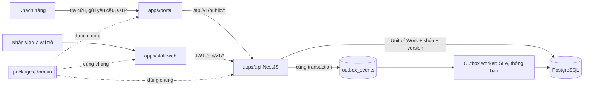

# WOMS – Quản lý hoạt động bảo hành của trung tâm hỗ trợ kỹ thuật

BTL Công nghệ phần mềm. Phiên bản tích hợp **0.3.0** (25/11/2026), gộp sản phẩm của các thành viên thành một hệ thống chạy được end-to-end:

| Thành phần | Công nghệ | Nguồn |
| --- | --- | --- |
| `apps/staff-web` – giao diện nhân viên (7 vai trò) | React 19, TypeScript, Vite, TanStack Router/Query, shadcn/ui | Thực (TV6) |
| `apps/portal` – cổng khách hàng (tra cứu, gửi yêu cầu, xác nhận báo giá) | React 19, Vite | Tường Anh (TV7) |
| `apps/api` – backend | NestJS 11, Prisma 6, PostgreSQL 17, JWT, Swagger, Transactional Outbox | thiết kế của Đạt (TV4), schema của Nam (TV5) |
| `packages/domain` – quy tắc nghiệp vụ dùng chung | TypeScript thuần | tách từ mock service của Thực, theo tài liệu hợp nhất 12/11 |
| `e2e` – kiểm thử đầu-cuối | Playwright | kịch bản theo bộ 58 TC của Hoài (TV9) |
| `docs/` | tài liệu nghiệp vụ, SRS, UML, ERD, QA | Tuấn, Hợp, Khánh, Nam, Đạt, Hoài, Khải |

Nguồn sự thật nghiệp vụ: `docs/nghiep-vu/WOMS_Ban_Cuoi_Hop_Nhat_Day_Du.docx` (21 trạng thái bảng 6.2, bảng quyết định D1–D10, PARAM-01..18).



## Chạy nhanh

Yêu cầu: Node.js 24, npm 11. Không cần Docker cho máy cá nhân.

```bash
npm ci
npm run build:domain

# 1) Bản chạy thử không cần backend (dữ liệu giả trong trình duyệt, cùng quy tắc nghiệp vụ)
npm run dev:web            # http://localhost:5173
npm run dev:portal         # http://localhost:5174

# 2) Chạy đầy đủ với backend + PostgreSQL thật
npm run db:local                                   # cửa sổ 1: PostgreSQL 17 cục bộ, cổng 5433
cp apps/api/.env.example apps/api/.env             # sửa nếu cần
cd apps/api && npx prisma migrate deploy && npm run build && node dist/seed.js && npm start   # cửa sổ 2: API :3000
VITE_API_URL=http://localhost:3000 npm run dev:web      # cửa sổ 3
VITE_API_URL=http://localhost:3000 npm run dev:portal   # cửa sổ 4
```

Swagger: http://localhost:3000/api/docs. Docker: `docker compose up -d --build` (xem [docs/DEPLOY.md](docs/DEPLOY.md)).

Tài khoản mẫu (mật khẩu chung `Woms@2026`, chỉ là dữ liệu thử): `tiepnhan`, `cskh`, `dieuphoi`, `ktv.an`, `ktv.binh`, `ktv.cuong`, `kho`, `qc`, `quanly`; `tiepnhan2` là tài khoản đã khóa. Cổng khách hàng: mã phiếu `CAS-20261106-0041` + SĐT `0912345678`; OTP thử nghiệm `000000`.

## Kiểm thử

| Lệnh | Tầng | Số test (25/11) |
| --- | --- | ---: |
| `npm run test -w @woms/domain` | Unit quy tắc nghiệp vụ, SLA, phân quyền, dữ liệu công khai | 67 |
| `npm run test -w @woms/portal` | Unit bản mẫu TV7 | 29 |
| `npm run test -w @woms/staff-web` | Component test trên trình duyệt (Vitest browser) | 44 |
| `npm run test:api` | Tích hợp API + PostgreSQL thật (RBAC, đồng thời, outbox, portal) | 37 |
| `npm run test:e2e` | E2E Playwright: giao diện nhân viên + cổng khách hàng (máy tính, điện thoại) | 27 |
| `npm run report` | Báo cáo + ma trận truy vết 58 TC → `reports/test-report.html`, `.md`, `.xlsx` | |

Kết quả lần chạy đầy đủ gần nhất: **204/204 test đạt; 53/58 test case QA có test tự động và đều đạt**. Chi tiết, quy ước gắn mã TC, và 5 TC còn kiểm thủ công: [docs/TESTING.md](docs/TESTING.md).

## CI/CD (GitHub Actions)

- `ci.yml` (mọi nhánh, mọi Pull Request):
  - typecheck, ESLint, Prettier, `npm audit`;
  - unit, rồi tích hợp API với PostgreSQL 17 (service container);
  - E2E Playwright;
  - báo cáo truy vết ghi vào Summary của lần chạy;
  - build thử 3 image Docker.
- `cd.yml`:
  - đẩy lên `main`: chạy lại CI, rồi đẩy image lên `ghcr.io/khainq12/woms-{api,staff-web,portal}`;
  - gắn tag `v*`: tạo GitHub Release kèm báo cáo kiểm thử và OpenAPI.
- `codeql.yml`: quét bảo mật mã nguồn (SAST).
- `dependabot.yml`: cập nhật thư viện hằng tuần.

## Tài liệu

- [docs/ARCHITECTURE.md](docs/ARCHITECTURE.md):
  - kiến trúc, luồng dữ liệu, Unit of Work, Outbox;
  - đối chiếu schema với ERD của Nam;
  - các điểm còn mở.
- [docs/TESTING.md](docs/TESTING.md): chiến lược kiểm thử, truy vết, nguồn tham khảo.
- [docs/DEPLOY.md](docs/DEPLOY.md): Docker, biến môi trường, phát hành.
- [docs/frontend/SUY_LUAN.txt](docs/frontend/SUY_LUAN.txt): các điểm TV6 tự suy luận, cần nhóm xác nhận.

## Quy trình làm việc nhóm

- Mỗi người làm trên nhánh riêng, mở Pull Request vào `integration`.
- CI phải xanh và có ít nhất 1 người review (mẫu PR trong `.github/`).
- `integration` → `main` khi chốt mốc.
- Test mới ghi mã TC trong tên để vào ma trận truy vết.
