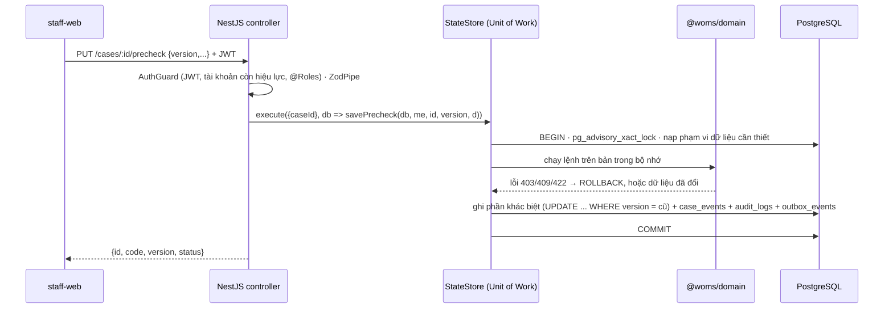

# Kiến trúc WOMS (bản tích hợp 25/11/2026)

## 1. Nguyên tắc

1. **Một nguồn quy tắc nghiệp vụ.**
   - `packages/domain` chứa toàn bộ quy tắc: 21 trạng thái, bảng chuyển trạng thái, D1–D10, ngưỡng duyệt báo giá, SLA giờ làm việc, kho, phê duyệt.
   - Frontend (bản chạy thử) và backend gọi **cùng một hàm**, nên giao diện và máy chủ không thể kiểm khác nhau.
   - Phần này tách từ `service.ts` của Thực. Mỗi lệnh có dạng `lenh(db, user, ...tham_so)`, thuần, không phụ thuộc nơi lưu dữ liệu.
2. **Máy chủ kiểm lại mọi thứ** (BR-27, AT-14):
   - giao diện chỉ ẩn nút;
   - API kiểm vai trò ở Guard (`@Roles`), kiểm kiểu dữ liệu bằng zod và bỏ khóa lạ;
   - rồi `packages/domain` kiểm quy tắc nghiệp vụ.
3. **Dữ liệu tối thiểu** (NFR-01):
   - `workspaceView` lọc theo vai trò: KTV, kho, QC không nhận SĐT/email khách và chỉ nhận phiếu được giao;
   - không bao giờ trả băm mật khẩu;
   - cổng khách hàng chỉ trả 5 bước công khai.

## 2. Thành phần

| Thư mục | Vai trò |
| --- | --- |
| `packages/domain` | `commands.ts` (lệnh nghiệp vụ), `statuses.ts`, `rules.ts`, `sla.ts`, `parts.ts`, `access.ts` (quyền xem), `public.ts` (dữ liệu cho khách), `dashboard.ts`, `seed.ts` (dữ liệu mẫu) |
| `apps/api` | NestJS: `modules/*` (controller REST), `common/` (JWT + RBAC guard, lỗi, zod), `store/state-store.ts` (Unit of Work), `outbox/` (Event Handler), `prisma/` (schema + migration) |
| `apps/staff-web` | Giao diện nhân viên. `src/api/service.ts` chọn `http.ts` (API thật) hoặc `mock.ts` (localStorage) theo `VITE_API_URL` |
| `apps/portal` | Cổng khách hàng. `src/api.ts` gọi `/api/v1/public/*`; mã gốc TV7 giữ ở `src/legacy-tv7` |
| `e2e` | Playwright, Page Object (`support/pages.ts`), dựng dữ liệu qua API (`support/api.ts`) |

## 3. Một lệnh ghi đi qua backend như thế nào

- **Đồng thời (NFR-02, EX-14):**
  - khóa tư vấn PostgreSQL buộc các lệnh ghi chạy tuần tự;
  - cột `version` chặn ghi đè, người thao tác sau nhận 409;
  - test TC-021, TC-027, TC-049, TC-050 chạy song song thật trên PostgreSQL.
- **Chống gửi trùng (EX-13):** header `Idempotency-Key` cùng bảng `idempotency_keys`.
- **Transactional Outbox (tài liệu "Event Handler" của Đạt):**
  - mỗi lần tạo phiếu hoặc đổi trạng thái ghi `outbox_events` trong cùng transaction;
  - `OutboxWorker` đọc từng dòng với `FOR UPDATE SKIP LOCKED`, sinh thông báo cho khách (kênh SMS mô phỏng) và mốc khởi tạo SLA, rồi đánh dấu đã xử lý;
  - `notifications.event_id` là khóa duy nhất, nên xử lý lại không gửi trùng (TC-051, TC-052);
  - tiến trình nền còn quét SLA để sinh cảnh báo nội bộ (TC-039).

## 4. Đối chiếu schema với ERD/SQL của Nam

| ERD v0.2 / `db/reference/01_create_oltp_tables.sql` | Schema Prisma (`apps/api/prisma/schema.prisma`) |
| --- | --- |
| users, roles, user_roles | `users` (enum `Role`: TN, CSKH, DP, KTV, KHO, QC, QL; mỗi tài khoản một vai trò, SUY_LUAN 1.4) |
| customers, devices | `customers` (SĐT duy nhất), `devices` (serial duy nhất) |
| warranty_cases + diagnoses + warranty_decisions + quotations | `warranty_cases`: cột tìm kiếm (status, code, version…), phần lồng nhau (chẩn đoán, kết luận, báo giá, QC, bàn giao, tạm dừng SLA, đổi phương án) ở cột `data` JSONB |
| work_orders + work_tasks + task_assignments + work_order_parts | `work_orders`: công việc, linh kiện (giữ/cấp/dùng/trả), lịch sử phân công ở `data` JSONB |
| parts, inventory_transactions | `parts` (CHECK tồn ≥ 0, giữ ≤ tồn), `stock_moves` |
| inspections, inspection_items, handovers | trong `warranty_cases.data` (qc[], handover) |
| case_status_history, workflow_transitions | `case_events` (lịch sử, seq tăng dần); bảng chuyển trạng thái nằm trong code (`statuses.ts`), có CHECK 21 trạng thái ở CSDL |
| audit_logs | `audit_logs` |
| sla_policies, sla_instances, sla_events | SLA tính từ dữ liệu phiếu (`sla.ts`, PARAM-08/09/16/17); mốc khởi tạo ghi `audit_logs` qua outbox |
| (không có) | `approvals`, `complaints`, `holidays`, `outbox_events`, `notifications`, `idempotency_keys`, `counters` |
| `02_create_dwh_tables.sql` (kho dữ liệu) | chưa tích hợp; ETL từ bảng OLTP trên sang DWH là việc tiếp theo của TV5 |

**Lý do dùng JSONB cho phần lồng nhau:** giữ nguyên mô hình miền mà frontend đã dựng và QA đã kiểm, nên tích hợp nhanh, ít rủi ro lệch. Hai việc còn lại:
- chuẩn hóa thành bảng riêng (quotations, inspections…) khi cần báo cáo SQL trực tiếp;
- ánh xạ sang DWH của Nam.

## 5. Điểm còn mở (cần nhóm quyết hoặc làm tiếp)

| # | Nội dung | Người chốt |
| --- | --- | --- |
| 1 | Các suy luận của TV6 trong `docs/frontend/SUY_LUAN.txt` (vai trò từng bước chuyển, quyền xem phiếu) đã thành quy tắc chạy thật | TV2, TV5 |
| 2 | OTP xác nhận báo giá đang là mã cấu hình (`PORTAL_DEMO_OTP`), chưa gửi SMS thật | TV7, TV1 |
| 3 | Ảnh hiện trạng đang gửi dạng data URL trong JSON (tối đa 10 ảnh, 3 MB/ảnh); cần kho tệp có phân quyền (TC-053) | TV4 |
| 4 | Khóa ghi toàn cục đủ cho một trung tâm; mở rộng nhiều chi nhánh thì đổi sang khóa theo phiếu/linh kiện | TV4 |
| 5 | Kho dữ liệu (`02_create_dwh_tables.sql`) và ETL chưa nối | TV5 |
| 6 | TC-004, 013, 028, 042, 053 chưa có chức năng tương ứng trong tài liệu hợp nhất (xem docs/TESTING.md) | TV2, TV9 |
